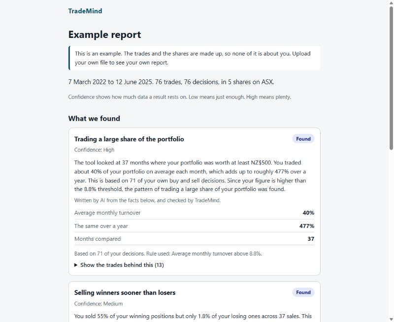
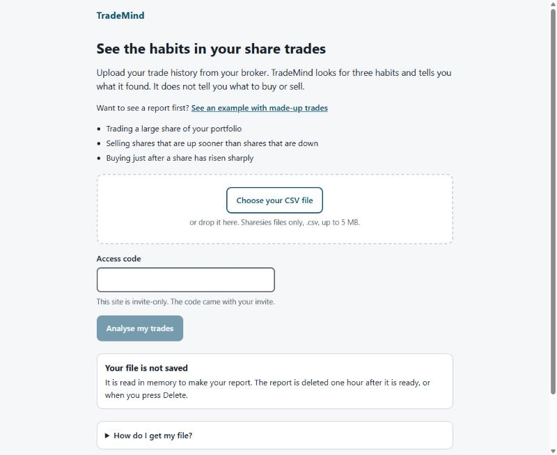
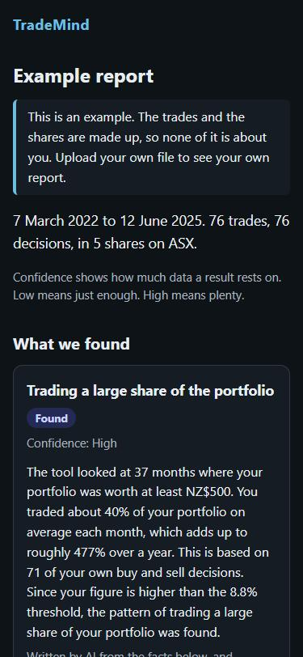

# TradeMind

TradeMind reads your share trading history (a CSV export from your broker) and shows you the behaviour patterns in it. Each finding comes with the trades behind it and a note on how much evidence there is.

It looks for three habits:

- **Trading a large share of your portfolio** each month (turnover, after Barber and Odean).
- **Selling shares that are up sooner than shares that are down** (the disposition effect, after Odean).
- **Buying just after a share has risen sharply.**

It describes past behaviour. It is not financial advice, and it never says what to buy or sell.

**Status:** version 1 is built and works with Sharesies files, on the command line and as a web app. Testing with a few invited users is next. See [`docs/`](docs/) for the vision, the spec and the milestones.

## See it

An example report, made from made-up trades (invented shares and a seeded random price history, run through the real code):



The upload page, and the example on a phone in dark mode:

| Upload (invite-only) | Example on a phone |
|---|---|
|  |  |

**The live site is invite-only.** To upload a file, you need an access code. The reason is market data: the prices come from a free source that is not licensed for a public app, and a licensed one costs money. The example report is open to everyone, because it needs no market data. You can run the whole thing yourself, with your own file, using the steps below.

## How it works

```
CSV  ->  ingestion  ->  enrichment  ->  analysis  ->  report (JSON)  ->  web page, API or text
         read trades    market prices   three          the main
                        and splits      patterns       product
```

A few decisions worth knowing about (the reasons are in the spec):

- **Patterns are found by rules that can be tested**, not by AI. A model only rewrites sentences that code has already written, and its reply is checked and thrown away if it adds anything. The report is complete without a model.
- **Market prices are checked against your own trades.** A provider's prices that disagree with what you actually paid are not used. This caught a provider that was wrong about a share consolidation.
- **Your file is not kept.** It is read in memory, and the report is deleted after an hour or when you press Delete.
- **Every finding says how much data it rests on**, and says plainly when there is not enough to tell.

## Running it

You need [uv](https://docs.astral.sh/uv/) (it installs the right Python itself) and Node 24.

```bash
uv sync
```

```bash
cd frontend && npm install && npm run build
```

```bash
uv run trademind serve
```

Then open http://127.0.0.1:8000. The API docs are at http://127.0.0.1:8000/api/docs.

From the command line:

```bash
uv run trademind analyse my-trades.csv --format text
```

Add `--explain ollama` (a local model) or `--explain groq` (needs `GROQ_API_KEY` in `.env`) for plain English explanations. Copy `.env.example` to `.env` for keys. Never commit `.env`.

## Development

```bash
uv run pytest
```

```bash
uv run ruff check
```

```bash
uv run mypy src tests
```

For the frontend, from `frontend/`: `npm test`, `npm run lint`, `npm run typecheck`. CI runs everything on every push.

To make the site invite-only, set `ACCESS_CODE` in `.env` before `trademind serve`. To remake the example report: `uv run python scripts/make_sample_report.py` (add `--groq` to have Groq write the explanations).

## Getting your Sharesies file

In Sharesies go to Account, then Reports. Choose Transaction Report, pick dates that cover all your trades, and export it as CSV.
